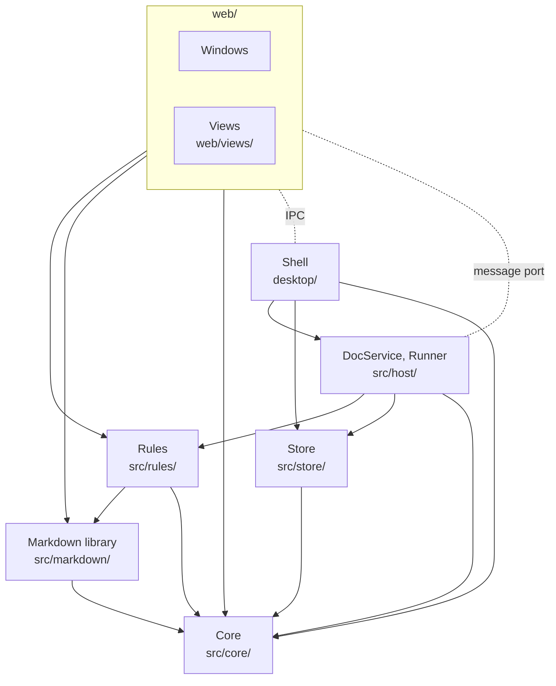

# Architecture

## Overview

How OpenDoc is built, in three parts. [The app](#the-app): the doc host, a
background process that does every file write and runs the AI buddies, and
the windows you edit in. [A buddy's turn](#a-buddys-turn): AI buddies are
agents that answer comments, and a turn is one AI buddy answering one
comment: the app starts an agent program on a copy of the doc, then merges
what it changed back in. (The code calls a turn a run: `Runner`,
`runs.jsonl`.) [Sharing](#sharing): how a teammate's browser joins the same
host.

Sharing, and the revisions every edit goes through with it, are designed,
not built. What they change is marked *planned*; everything else is what
the code does.

No backward compatibility with earlier formats: a version 1 sidecar is
ignored, and a version 2 one is not converted. A sidecar this version must
not write (another version, or no header) shows its comments read-only,
with a way to fix it.

### Principles

1. **Files are the truth.** Docs, sidecars and buddy files are plain files.
   Everything else is a cache, rebuilt from them, or only costs undo if
   lost.
2. **Only the app writes them.** An agent gets only a copy. Any other
   change (other editors, `git pull`) is seen and merged.
3. **An agent is a filter:** prompt on stdin, copies of the doc and its
   comments to edit, reply on stdout. It knows nothing of OpenDoc and
   remembers nothing.
4. **No one resolves a conflict by hand.** Between people, nothing typed is
   dropped: the host orders their edits and merges them by character. An
   AI buddy's edit, or one from outside, yields to a person's. What loses is
   redone (ask the buddy again) or restored (history).
5. **AI buddies always edit, and every edit can be undone.** See
   [Undoing changes](#undoing-changes).
6. **Only a person's comment starts a turn:** mine, or a teammate's who can
   edit. Nothing in a shared file makes an AI buddy run, or chooses what
   program runs, on this machine.
7. **One component does one thing.** If it takes two sentences to say what
   a component does, it is two components.
8. **The fewest interfaces.** A new call is the last resort: first reuse one
   that exists, or delete the need. Who a writer is (a person, a buddy) is
   known only at the door every call comes through, never by the component
   that merges.
9. **Never take mutable state as the truth.** Find and join things by a
   stable id; a name, a path or a color is an alias that may change, kept
   only for show. A buddy is its id, not its name.

## The app

### Doc mode and project mode

The app has two modes:

- **Doc mode:** a `.md` file opened on its own (from Finder, say). One
  doc, one buddy: Clippy. That holds even if the file sits in a project
  folder.
- **Project mode:** a folder opened from the home page. A file tree and
  its docs, Clippy, and the project's own buddies. They live in
  `.opendoc/buddies/` at the folder's root and travel with it
  ([PROJECT](../spec/PROJECT.md)).

| | Doc mode | Project mode |
| --- | --- | --- |
| Opened from | Finder: a `.md` file | The home page: a folder |
| Window | One doc | File tree and docs |
| Folder | none | the opened folder |

The asymmetry is intentional: doc mode is a light editor for one person
and Clippy, with no team and no sharing; project mode is the full
experience, many docs, many AI buddies and a team.

Clippy is the same in both modes: who it is lives in the user's config
folder, not in any project. That is what sets it apart from every other
buddy ([PROJECT §2](../spec/PROJECT.md)):

| | Clippy | Project buddies |
| --- | --- | --- |
| Reached from | every doc, in either mode | docs in their project only |
| Who it is | the user's `buddies/Clippy.md` in their config folder; built in if missing or empty | `.opendoc/buddies/<Name>.md` in the project |
| Travels with | the user | the project folder |
| Name, face | the app's; a project's `Clippy.md` is ignored | the file name; a face made from its id |
| Color | yellow, its own | one of the other seven, picked by id |

### Components

A solid arrow is an import: `npm run lint` allows no others
(`.dependency-cruiser.js`), and no imports that go in a circle. A dotted
line is a message between processes.

| Component | Owns |
| --- | --- |
| Format | `X` + `X.opendoc.jsonl`, anchors on X's text ([SPEC](../spec/SPEC.md)) |
| Core (`src/core/`) | computing on text, the same in the doc host and the page; no I/O: anchors, diff (Myers', `diff.js`), text operations and how they merge (`ot.js`), the sidecar's lines and threads, @mentions and the inbox, what a buddy file and the settings may hold |
| Markdown library (`src/markdown/`) | not a view or a rule; what both Markdown ones use: a doc's rendered text and its map back to the source (`project.js`), and saving with the bytes of unchanged blocks kept (`splice.js`) |
| Rules (`src/rules/`) | built in; how a format's edits merge, whoever made them. See Views and rules |
| Store (`src/store/`) | the files: a doc and its sidecar, each written whole (`files.js`), watched (`watch.js`), and the doc's versions (`history.js`); the settings and agent scripts in the config folder; buddy files (Clippy's there, a project's in its folder) |
| DocService (`src/host/doc-service.js`) | every write to a doc and its sidecar, one at a time; outside changes; versions |
| Runner (`src/host/runner.js`) | which turns should start (the inbox), runs them, their status in memory |
| Windows (`web/`) | the doc page: editing and commenting, through DocService. The page talks to its editor, a view, in offsets on the doc's text, turns its typing into operations and takes others' back (`client.js`), and works out the marks a view draws (comments, a draft, a revision). The page knows no format. Also the home page (`start.js`) |
| Views (`web/views/`) | built in; a doc's editor: what a person sees and types in. See Views and rules. The Markdown view's parts are also in `web/`: `diagrams.js`, `markdown-schema.js`, `pm-text.js`, `review.js` |
| Shell (`desktop/`) | the app: windows, menus, dialogs, recent docs and folders, a project's files in the sidebar; starts the doc host (`doc-host.js`) and gives each page its port to it (`preload.cjs`). An open doc's files only through its DocService; the settings, the agent scripts and files that are not open, through Store |
| Team, ProjectService | *planned:* who is on a project and what each may do; the project's files, the same for everyone. See Sharing |

DocService and Runner run in the doc host, the app's utility process.
Windows reach it over Electron message ports; a teammate's page, *planned*,
over a relay.

### Views and rules

A doc has one **view** and any number of **rules**. They share only the
doc's text: no view imports a rule, no rule a view, and each is switched on
or off alone (`settings.json`: `views` and `rules`, each by id).

| | View (`web/views/`) | Rule (`src/rules/`) |
| --- | --- | --- |
| Is | the doc's editor | how a format's edits merge, whoever made them: a buddy, another program |
| Shape | has state (caret, undo, marks), so it is built in and not an extension point | a declaration of pure hooks: text in, verdict out; no state, no lifecycle, no I/O, no handle to the app |
| Declared | `{ id, name, about, extensions, always?, limits?, createView, settings }` | `{ id, name, about, extensions, ...hooks }` |
| Picked by | `viewFor(name, settings)` in `web/views/index.js`: the first enabled view that claims the extension, else Plain text (`always`, any UTF-8 text file up to 20 MB); a view only for a doc within its `limits`, see Latency | `rulesOf(path, settings)` in `src/rules/index.js`: every enabled rule that claims it |
| Runs in | the page | the doc host (an edit that yields: a buddy's, an outside change, an undo) and the page (one landing while typing is on its way), whatever the view |
| Its settings | an ordered list of fields `{ key, type: 'switch' \| 'choice' \| 'number', label, hint?, default, group?, when? }`, rendered as its page in Settings > Views; `viewSettings` keeps a stored value only if its field allows it | the switch only: Settings > Rules; `ruleSettings` |
| Must satisfy | the view contract, `test/views.test.js` | each hook's contract, below |

The Plain text view (`web/views/plain/`) is CodeMirror showing the text as it
is; line numbers, wrapping, font size, whitespace marks, indent guides and
indentation are its settings, with a status bar (`status.js`) whose menu and
toggles save the same settings. The Markdown view (`web/views/markdown/`, [design](markdown-view.md)) is
WYSIWYG; its toolbar (the only formatting entry), outline, focus mode and
word count are parts of it, switched by its settings, not separate extensions.
It maps the doc's text to its own document through the rendered text, and
saves each block the user did not change as it was written.

**Hooks.** A hook is optional and may only refuse; the host applies the
result. One exists: `mergeLine(base, ours, theirs, merged)`, whether a line
both sides changed may be merged by character into `merged`. If any rule of
the doc refuses, the line conflicts, and the human's text stays. The Markdown
rule (`src/rules/markdown.js`) refuses a merge that would change how the line
renders. Off, a `.md` merges as plain text. A switch applies from the next merge.

**To add a view**: a folder in `web/views/` with its declaration, listed in
`VIEWS`, passing the contract test. Its features are its own settings. Views
are not a third-party extension point: a view owns state no hook can.

**To add a rule**: a file in `src/rules/` exporting a declaration, listed in
`RULES`. One concern per rule; a format gets several rather than a bigger one.
A rule may use the libraries in `src/` (`src/markdown` for rendered text) and
nothing in `web/`, since the doc host loads only `src/`.

**To add a hook**: have the host call it at one place, with plain values in
and a verdict out, and say what it may refuse in `src/rules/index.js`. Add one
only when a rule needs it.

Settings keep `views: { <id>: { enabled, ...values } }` and `rules: { <id>: { enabled } }`;
the core checks only that shape (values boolean, string or number) and keeps
ids it does not know. Switching a view makes the affected views again from
the same text in every window, the history's too, after saving pending
typing; its own settings reach its view as they are.

### Latency

Writing feels natural only while the page keeps up, a teammate typing too.
Every view keeps one promise (`LATENCY` in `web/views/index.js`) for any doc
within its limits:

| From | To | Within |
| --- | --- | --- |
| the doc's text | an editable view | 3 s |
| a key | its character in the doc | 30 ms median, 100 ms p95 |
| a teammate's edit arriving | it shown (the network aside) | 50 ms median, 100 ms p95 |
| the doc opened | the end of any one task that keeps the page busy | 500 ms |

A view keeps it only up to a size, its `limits`: how long the doc is, and
for the Markdown view how long a run of text without a blank line is (one
paragraph is parsed whole on every edit in it):

| View | Up to | Past it |
| --- | --- | --- |
| Markdown | 100,000 characters; no block over 10,000 | opens as plain text, and says so; the person may choose the Markdown view anyway, for that window |
| Plain text | 5,000,000 characters | opens read-only, and says so |
| Plain text's colour | no block over 10,000 characters | the doc opens without colour |

The desktop app opens text files up to 20 MB, room for the plain view's
limit in any script. `test/perf/latency.test.js` (`npm run test:perf`, a CI
job on every pull request) opens each view at its limits, in the doc shape
that costs it most, types while a teammate's edits arrive, and fails when
the promise is missed twice running. Two dependencies are quadratic in one
paragraph's length; installs and builds patch them in node_modules, for the
page and the doc host alike (`scripts/patch-deps.js`), until
they are fixed upstream.

### Interfaces

The target: each component does one thing (principle 7) through the few
calls below (principle 8). Done: one `comment` call and one function that
builds a comment (#177), the Runner's `reconcile` (#178; the code calls
`stop`/`resume` for `pause`), `DocService.move` (`moveTo`, which the Shell
calls to rename an open doc), and every edit as operations on a revision,
with the views' side of them (#215; the code calls Undo on a reply
`undoReply`, and a restore is still its own call, `restoreVersion`). Not
yet: Config, History and Store as the components below (today they are the
modules of `src/store/`), and the rest of what [Sharing](#sharing) needs:
teammates, Team, ProjectService and `cursor`. The door is built for the
owner and AI buddies (#223).

**Every writer comes through one door.** A page's call comes as
`call(type, arg, who)`, `who` being `{ id, name, kind, level }`. Each call
needs a level, `read < write < owner`, and the door lets it through only
when `who`'s level is at least that: `can(who, level)`, asked once; nothing
behind it checks again. A buddy's finished turn lands as the buddy, with
the level of whoever asked it. That is all
a permission is. What a writer does with it is behavior, decided elsewhere:
when an AI buddy resolves is its prompt's business, and whether an edit
**yields** is its path's (a window's never; a buddy's turn, an outside
change and an undo always). Behind the door DocService uses `who` only to
put in a comment's `by`. A connection is bound to one doc at a time, as a
window's port is, so no call names a doc.

| Calls | Level |
| --- | --- |
| `state`, `history`, `version`, `cursor`; ProjectService's `list`, `read`, `open` | read |
| `submit`, `undo`, `comment` (resolving and reopening too) | write |
| everything else: `move`, settings, AI buddies, agent scripts, Team's own calls | owner |

The owner's level is owner. An AI buddy's turn acts with the level of
whoever asked it, at most write, as a Unix program runs as the user who
started it; a teammate's is read or write.

**Every edit is operations on a revision.** A submission is insert and delete
operations (offsets in UTF-16 code units of the doc's text) on
`{ epoch, rev }`, the revision it started from. DocService transforms it
against what landed since: one function, `transform` (`src/core/ot.js`), two
policies. A person's edit merges by character and loses nothing. An edit
that yields is dropped wherever anything changed the same line since, unless
both changed one line in places apart and the doc's rules allow a character
merge there; what was dropped comes back (a buddy's reply says `conflict`).
It yields to a person's edit that started before it too, though it reached
the host first; a buddy's turn that loses part of it so is marked
`conflict` on its version in history, since its reply is already written. Of two edits that yield, the first to land wins. An edit
lands on the text in memory, the file is written, and only then does it go
to every window as `ops` (`{ epoch, rev, ops, id }`, `id` the window's name
for its own edit; `yields`, and a buddy's `reply` and `by`): a window
rebases what it has typed and not yet heard back (`web/client.js`). The
epoch changes when the doc host starts: a window that sees a new one takes
`diffOps(the text it last heard, the new text)` as what landed and rebases
on that, the same function again; its edit on its way is in that text if
the new host lists it as `landed`, read from what the one before noted, in
the doc's history folder, just before it last wrote the file. A window's edit on a rev the log no
longer holds is refused as `stale`, and the window does the same. The log
holds the last 1,000 edits, for windows' edits only: a buddy's turn, an
outside change and an undo each have their base text (the turn's copy, the
text the file last held, the version saved after the turn) and take
`diffOps(that base, the text now)` as what landed since, so they need no
log, after a restart or days later. History records a version when typing
pauses, before and after each buddy's edit, an outside change, an undo or a
restore, and when the history is opened.

**Undo on a reply is one edit**: the inverse of the turn's, from the
versions saved before and after it, rebased with `transform` over
everything written since as an edit that yields, so text someone changed
since stays. Cmd+Z is the editor's history, which holds only your own
typing, mapped over what others put in; its result is your typing, which
does not yield: an undo must not give way to a buddy's edit.

| Component | Its one thing | Interface |
| --- | --- | --- |
| Core | compute on text, purely; the page and the host share it | `diffOps(base, text)`, `transform(ops, landed, { yields, rules })` → `{ ops, dropped }`, `apply(text, ops)`; `createAnchor`, `locate`; `parseSidecar`, `serializeSidecar`, `newComment`, `threadsOf`, `askedOf(thread, askers)` |
| Store | read, write, watch and move files | `read(path)`, `write(path, text, { ifHash })`, `watch(path, fn)`, `move(from, to)`. Settings, buddies, agent scripts, history and the team are paths and parsers over these, not interfaces of their own |
| DocService | order every edit to a doc, and write it | `state()` → text, `{ epoch, rev }` and what this connection may do; `submit({ ops, epoch, rev, id })` → `{ rev }`, or `stale`; `comment({ thread?, anchor?, body, resolved? })`; `undo(replyId)`, a turn undone as above; `cursor(at)`; `move(to)`; events `ops` (every landed edit, written), `sidecar`, `team`, `cursors`, `missing`; a window that connects again calls `state`. Cursors are never queued behind writes |
| History | keep the doc as it was at each version | `record`, `list`, `read`; a version may have several authors |
| Runner | make the running turns equal the asks the sidecar holds | `reconcile()`, `statuses()`, `pause(on)`. The asks are people's comments: the owner's and those of teammates who can edit. A finished turn comes through the door as its buddy |
| Team | who is on the project and what each may do | for the owner `allow(id, access)`, `remove(id)`, `set(id, { access })` with `access` `read` or `edit`, `link()`; the door asks it a `who`'s level; a request to join comes from the relay as `join({ id, name })` |
| ProjectService | the project's files, the same for everyone | `list(path)`, `read(path)`, `open(path)`, for the owner's windows and a teammate's page alike. A path must resolve inside the root and not start with `.`. An agent reads no more than this |
| Config | own the settings, buddies and agent scripts | `settings.get/patch`, `buddies.save/remove`, `scripts.list/reset` |
| Rules | say whether a character merge would change how a line renders | `rulesOf(path, settings)` → rules with `mergeLine?`; asked only for an edit that yields |
| View | the doc's editor: what a person sees and types in | its contract as today (`getText`, `applyText`, `setMarks`, the selection); the page turns its text into operations and back (`web/client.js`, [plan A](markdown-view.md#many-writers)) |
| Shell | windows, menus, dialogs, recent docs | an open doc's files only through `DocService` (renaming through `DocService.move`), the sidebar through ProjectService; the settings and agent scripts through Store and Config |
| Agent | edit its copy, append to its sidecar, print a reply | none: it cannot call anything |

The page's calls: `state`, `submit`, `comment`, `undo`, `cursor`, `history`,
`version`, ProjectService's three, and for the owner settings, buddies,
agent scripts and Team. `reply`, `resolve`, `reopen`, `saveDoc` and
`restoreVersion` go: a reply, a resolve and a reopen are each `comment`; a
restore is a `submit` of the operations back to an old version's text, so it
needs edit, as typing it would.

A **journal** of what happened (history, comments, `runs.jsonl`) is not a
component: if it is wanted, a view joins the three by `reply` and `thread`
when read. Nothing stores it.

### How files are read and written

- DocService reads the doc and its sidecar when the doc opens, keeping a
  hash of each. Windows never read the files; they ask DocService, which
  holds the doc's text as its edits land (see Interfaces) and writes it as
  each lands, before telling the windows.
- It watches both files, through a folder watch and a poll every 500 ms
  for file systems where watches miss changes. When the sidecar's hash
  changes, it tells every window; a doc it did not write is a change from
  outside: saved to history first, then landed as an edit that yields, from
  the text the file held when last written. Where it overlaps what was typed
  since, the typing wins and the outside version is only in history.
- Before writing, DocService checks the file is still what it last wrote;
  if not, it lands the outside change first, the same way.
- Every file is written whole: a temporary file in the same folder,
  renamed over it.
- Above the files, a doc is its text: UTF-8, no byte order mark, lines
  ending in `\n`. The file's byte order mark and CRLF line ends are put
  back when it is written; a file that is not UTF-8 does not open.

### Undoing changes

An undo takes some edits back, all at once, and keeps everything written
since: where someone changed that text since, their text stays.

1. **Your own typing:** Cmd+Z, which undoes only yours, as in shared docs.
2. **An AI buddy's turn:** Undo on its reply: the edits between the versions
   saved before and after the turn.
3. **Anything else:** restore a version from history.

Each saves a version first. Undo on a reply is the same `transform` every
edit goes through (see Interfaces): the turn's edit taken back, yielding to
what changed since. It works where the versions are, on the doc host;
*planned*, from any window of the team. Cmd+Z is the editor's own history,
your typing only, and its result is typing like any other: a person's
edit, which does not yield.

### The config folder

In the config folder (`~/Library/Application Support/OpenDoc/` on macOS),
written only by the app.

| File | Holds |
| --- | --- |
| `settings.json` | the user's id and name; editor preferences; views' and rules' settings; which agent runs buddies |
| `agents/` | agent scripts; Claude Code, Codex and the OpenDoc agent ship |
| `state.json` | recent docs and folders, window bounds |
| `history/` | versions of each doc, saved before and after each buddy edit (tagged with its reply's id), before each outside change, undo and restore; and the windows' edits the doc's file was last written with |
| `team/` | *planned:* each project's teammates and their access |

## A buddy's turn

A thread waits on AI buddy X (by id) when a person's comment that may ask, newer
than X's last comment there, asks X: today this machine's user's, *planned*
also a teammate's who can edit. A comment asks whom it @mentions; one that
mentions no one asks the thread's AI buddies: the one that opened it, and
each @mentioned there before. An empty one (resolving, reopening) asks no
one. That is computed from the sidecar and the ids of those who may ask. AI
buddies run only on docs open in a window.

### How a turn works

1. Runner copies the doc and its sidecar into a new private folder and runs
   the [agent script](agent-config.md) there, with the prompt (who the
   buddy is, the thread, the rules) on stdin and the buddy's name in
   `OPENDOC_BUDDY` (the name is for the script; the app goes by id).
2. The agent edits the doc copy, appends comments to the sidecar copy, and
   prints its reply on stdout.
3. On exit 0, DocService saves versions before and after, lands the doc
   copy's diff, from the copy as it started, as an edit that yields (see
   Interfaces), adds the appended comments as the buddy's, and writes the
   reply as the buddy's comment. Where a person changed the same line
   meanwhile, the buddy's change there is dropped and the reply is marked
   `conflict`. The turn lands as the buddy's.
   The reply and comments are dated just after the last comment the turn
   was given, so a comment the user wrote meanwhile still waits on X.
4. The private folder is deleted, and the turn gets a line in the config
   folder's `logs/runs.jsonl`: doc, buddy, thread, start, duration, and
   `ok`, `failed`, `timedOut` or `stopped` with the exit code.

Resolving a thread ends its turns at once, with no answer; a turn that
ended but is not merged yet is dropped. Deleting a buddy ends its turns too.

An AI buddy comments as a person does: new threads, replies in any thread.
It resolves the thread it answers when the comment asks it to: its reply
carries `resolved`. Anything else is ignored
([agent config](agent-config.md#comments)). Its comments start no turns
(principle 6).

### What the user sees after a turn

What the app knows, the app shows, not the buddy's reply: under the reply,
how many places the turn edited, with Undo; a dropped change marks the reply
`conflict`; its comments are in the margin. The reply says only what the
app cannot (why, what to decide), and may be empty. The turn's edits land at
once, shown as a revision (new text in the buddy's color, removed text
struck through) until the user next types or another turn's edits land;
clicking the count shows them again. The count, the revision and Undo are
read from the version saved after the turn and the one before it: today on
the machine that ran it only, *planned* in every window of the team, since
the versions are on the host.

### Failures, retries and restarts

A turn that fails is answered too: the buddy's comment is marked `failed`,
with the end of the program's output. One ask, one reply; to retry, or to
redo a `conflict`, @mention the buddy again. Which turns are working lives
only in memory: after a restart, unanswered asks run again. Turns go on at
the same time; their merges are applied one at a time.

## Sharing

*Planned.* A teammate joins the owner's project from a link, in a browser.
The files stay on the owner's machine. Teammates are trusted: in a doc a
teammate who can edit does what the owner does. Doc mode has no sharing.

- **One host.** The owner's doc host holds the files, does every write and
  runs the AI buddies, as always. A teammate's page is a client of it: it
  keeps only what it shows, and a reload resyncs it from the host. While the
  host is offline no one edits; the app keeps the computer awake while
  teammates are in, and a page waits and reconnects by itself.
- **A relay** (a Cloudflare Worker, one Durable Object per room) joins the
  host's outgoing WebSocket to each teammate's, over TLS, and stores
  nothing. There is no encryption of our own: the relay is ours, and it
  could read what passes.
- **One seam.** A page talks to the host through `{ call, onEvent }`: in the
  app a message port, in a browser the relay. The host serves both the same
  way, adding a `who` to every call. The browser build already exists in
  `preview/`, where `doc-stub.js` plays the host; the relay replaces it.
- **Everyone is a participant**: `{ id, name, kind, level }`. The host sets
  `who` from the connection (a
  teammate's id is made once in their browser; an AI buddy's is in its file)
  and never trusts one sent in a message. Names are unique on a project,
  people's and AI buddies' together. `can(who, level)` is the one place
  that decides:
  - *Owner:* rename, move, delete and create files; settings, AI buddies
    and agent scripts; and all a teammate who can edit may.
  - *A teammate's access*, Read or Edit (write), set when the owner allows
    them and changed in the Team panel. Edit is everything the owner does in
    a doc: edit, comment, resolve, ask AI buddies.
  - *An AI buddy* acts with the level of whoever asked it, at most write.
  - A comment's `kind` (`human`, `ai`) says only whether an agent is behind
    it; it decides nothing.
- **Joining.** The link is one per project, permanent until the owner makes a
  new one, and grants nothing by itself. A first join asks the owner, with a
  notification, and waits for Allow, where the owner picks Read or Edit;
  Allow binds the teammate's id to that browser. A name already taken on the
  project is refused at the door, and the teammate picks another. Remove
  ends one teammate; a new link ends every old one.
- **Scope is the project folder**, served by a `ProjectService` to the
  owner's windows and teammates alike, so both see the same tree. A path is
  resolved to its real path and must be inside the root; a link out of it,
  or a name starting with `.`, is refused. An AI buddy's agent reads no more
  than that, so nothing hidden reaches a doc through it.
- **One order.** The host orders every edit to a doc, people's and AI
  buddies' alike, and a person's typing is never dropped; see
  [Interfaces](#interfaces). How the Markdown view takes part is
  [its own design](markdown-view.md), to be proven by a prototype first.
