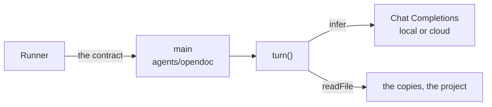

# OpenDoc Agent

An agent of our own, run like Claude Code and Codex: a script in
`agents/` under the same [contract](agent-config.md#the-contract). Inside,
an LLM reads and proposes; the program checks and applies.

Claude Code and Codex are black boxes (their prompts, shell and web tools,
permissions, start-up time) for work that is narrow: read, comment, edit
text. Our own loop for only that runs any model, local ones included, whose
data never leaves the computer.

## Principles

1. **Read and propose, never write.** The model's only effect is a
   proposal; the program checks it and applies it to the copies.
2. **The tools are the permissions.** `read` and `propose` only: no shell,
   no network. Text a teammate wrote can at worst make an undoable proposal.
3. **Stateless.** A turn remembers nothing after. Within it, all state is
   the messages, and their log replays it.
4. **The model asks for context.** The first message is small; the model
   reads what it needs.
5. **Read by line number, write by quote.** Never count characters.

## Interfaces

| Interface | Called by |
| --- | --- |
| `turn({ prompt, doc, sidecar }, { infer, readFile }) → { edits, reply }` | the program's `main` |
| `infer(messages, tools) → { name, args }` | `turn`, for each step |
| `read`, `propose` | the model, as tools |

**`main`** is all the I/O, and all of the contract: it reads the prompt on
stdin and the paths in `OPENDOC_DOC`, `OPENDOC_COMMENTS` and
`OPENDOC_PROJECT`, calls `turn`, applies the edits to the copies, prints the
reply and exits 0.

**`turn`** is one buddy answering one thread, with no I/O of its own: it
thinks, and checks what it proposes. `prompt` is stdin as is; `doc` and
`sidecar` are the copies' paths. It throws when the turn fails.

**`readFile(path)`** gives a file's text, a folder's entries, or null, and
is all the turn can see: the copies, and in project mode the project's files
(inside the folder, not starting with `.`, sidecars included).

**`infer`** is one step of the model, over the OpenAI-compatible Chat
Completions API, which local servers and most clouds speak. It sends
`tool_choice: "auto"`: current Claude models refuse a forced tool call, and
a reply without one is sent back anyway. Endpoint, model and key are in the script, as Claude Code's
flags are in its own.

**`read({ path, lines? })`** returns the text with line numbers, from line
`lines[0]` to `lines[1]`. A file over 20,000 characters without `lines`
returns its outline instead (Markdown headings with their line ranges); a
folder, its files.

**`propose({ edits: [{ path, old, new }], reply })`** ends the turn. On the
doc, `old` must be found exactly once. On its sidecar, `old` is empty and
`new` appends comment lines ([agent config](agent-config.md#comments)). Any
other path is refused. One bad edit sends the whole proposal back, saying
what to fix. `reply` is printed, and may be empty.

## The loop

```
step(messages, budget):
  call = infer(messages, tools)
  if call is a valid propose: return its args
  if budget is 0: fail
  return step(messages + call + result(call), budget - 1)
```

The first message is the prompt, as is: its rules are every agent's. The
tools match the contract it describes: `propose` edits the doc and appends
to the sidecar, and its `reply` is what the prompt says to print. Twenty
steps, and the turn fails.

## Architecture



- **Shipped, then the user's,** like the other scripts: theirs to read,
  change, or rewrite in any language that keeps the contract.
- **Tests** call `turn` with a fake `infer`.
- **Each turn's messages are logged** to a file the script names.

## Steps

1. Doc mode: `main`, `turn`, `infer`, tests with a fake `infer`.
2. Project mode: `readFile` over the project folder.
3. The log of each turn's messages.

## Open questions

- Later: `search`, if models spend steps finding things; web access, off by
  default, the one tool that could send a doc out.
