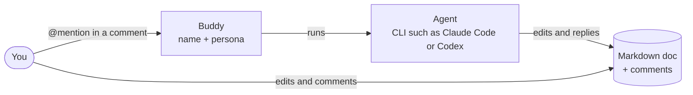

# Product Vision

AI buddies collaborate with you in the same Markdown doc, in real time, like teammates.

## Background and Problem

Document editing is one of the most fundamental and enduring uses of computers. Human collaboration on documents has gone through two stages:

- **Sequential collaboration** (e.g., Word): User A finishes editing a Word doc and emails it to User B, who marks changes with Track Changes and comments, then sends it back to User A for review
- **Real-time co-editing** (e.g., Google Docs): User A and User B edit the same doc at the same time

Writing with AI is now inevitable, yet human–AI collaboration is still stuck in the sequential stage: a person leaves comments in the doc or in a chat box, the AI reads them and revises the doc, then hands it back.

## Our Solution

Our product moves human–AI collaboration into the real-time stage: the AI is no longer a tool in a chat box, but a collaborator in the doc. We call this collaborator a **buddy**: a name and a persona that you @mention in a doc, as you would a teammate. Behind each buddy, an **agent**, a command-line program such as Claude Code or Codex, does the work.

People and buddies work on the same doc at the same time, discussing in comments and each making their own edits, just like two teammates reviewing a proposal together.

## Design Principles

- **You are in control**: Buddies never take over the doc. They make only small, scoped changes to what you asked about; the app shows what each run changed, and you can undo it in one click. Only you resolve a thread
- **Real-time collaboration**: No handing the doc back and forth. You and your buddies edit and comment in the doc at the same time without blocking each other
- **Many buddies, not just one**: Many personalized buddies see the same doc and threads you do, act through the same edits and comments, and reply to each other in threads
- **Familiar experience**: Edit, comment and @mention, like your favorite doc collaboration app. Nothing new to learn
- **Open**: Open source, plain Markdown with an open comment format, and any command-line agent

## Non-Goals

- **Cloud documents**: Docs live only on your machine; no cloud storage
- **Real-time collaboration between people**: We focus on human–AI collaboration, not real-time collaboration between people
- **Proprietary document formats**: Plain Markdown only
- **Knowledge base**: We work on a doc or a project folder, not note management
- **Chat interface**: All communication happens in comments; no chat window

## Target Users

We start with people who already write docs with AI. They:

- Want working with AI to feel as smooth as working with a human teammate, without copying and pasting between a chat box and a doc
- Mostly write locally and keep docs next to their code (e.g., READMEs and design docs in a GitHub repo)
- Value open standards and software, and don't want to be locked into a subscription service

## Core Use Cases

- **AI writes, human edits**: The AI drafts a design doc; I review it as I read and use comments to ask a buddy to fine-tune specific paragraphs
- **Human writes, AI edits**: I've written a 10,000-word novel. I don't want the AI making sweeping changes that mess up the whole thing, only fine-tuning a few paragraphs
- **Alongside chat-based agents**: Hand big changes to a chat agent's CLI or desktop app, and make small changes by commenting directly in the doc. The page also works as a reader

## Competitive Landscape and Differentiation

Existing tools fall into four categories:

| Category | Examples | Strengths | Weaknesses |
| --- | --- | --- | --- |
| **Cloud docs with built-in AI** | Google Docs + Gemini, Notion AI, Word + Copilot | Real-time co-editing between people; agentic edits in the doc | Locked to the vendor's AI; cloud-only, proprietary format |
| **Chat AI canvases** | ChatGPT Canvas, Claude Artifacts | Generate and edit docs in a chat | Chat-centric; not local; no comment threads |
| **AI code editors and CLI agents** | Cursor, VS Code + Copilot, Claude Code | Powerful agents on local files | Built for code, not for discussing prose paragraph by paragraph |
| **Local Markdown editors** | Obsidian, Typora + AI plugins | Local, open format | AI is a plugin; no comments; no external agents |

How we're different:

- **A shared live doc, not turn-taking**: The doc stays open to everyone. You keep writing while a buddy handles your comment, and it acts as soon as you @ it instead of waiting for you to hand the doc over.
- **Comments are the interface**: You comment, the buddy edits and replies in the thread, you resolve. No switching to a chat box.
- **Local, plain Markdown**: A regular file in your repo, comments stored alongside it; no subscription lock-in.
- **Any agent, many buddies**: Any command-line agent can plug in, and several buddies can work in the same doc at once. A project's buddies are files in the repo, so everyone who clones it gets them.

## Success Metrics

- **User in control**: The AI never takes over the doc. Measure edits that go beyond the comment's scope and the share of runs users undo.
- **Less waiting**: Measure time from an @ to the buddy's reply, and how long people and buddies wait on each other.
- **Many buddies**: Measure the share of docs with 2+ buddies and the number of buddy edits dropped in conflicts.
- **Better writing experience**: Beat an editor + AI plugin on completion time and satisfaction for the same task; track weekly active docs and retention.
- **Open**: Docs open correctly in any Markdown editor; count the third-party agents that connect.
